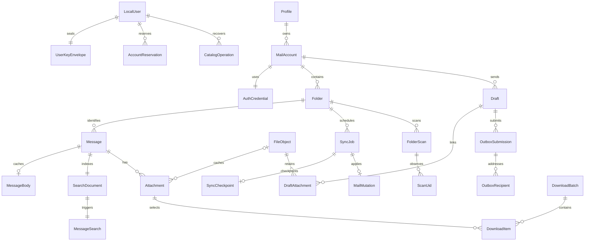

# 数据库详细设计

权威建表定义：[目录库](sql/catalog.sql)、[每用户库](sql/profile.sql)；逐字段字典见[DATA_DICTIONARY](DATA_DICTIONARY.md)。两份SQL均为新建v1设计，不是对阶段二测试库的升级脚本；不得在原型库上直接执行以冒充产品迁移。

## 存储拓扑与隔离

```text
%LOCALAPPDATA%/MailHub/
  catalog.db (+ -wal/-shm)
  profiles/<不可变userId>/profile.db (+ -wal/-shm)
  profiles/<userId>/objects/<随机fileId>.bin
  profiles/<userId>/staging/<随机operationId>.tmp
```

最多四用户由LocalUser.slot唯一CHECK强制；名称不是目录名。目录库只含身份验证、密钥封套、地址HMAC唯一预留及跨库恢复记录，不含邮件内容；AuthCredential只存在用户库。用户库Profile唯一属主，其他记录由该库隐式归属，Account显式owner_id再关联Profile。其他Windows账户不在此应用用户测试范围，不用DPAPI CurrentUser冒充应用隔离。

## ER



完整属性ER见[diagrams/er.mmd](diagrams/er.mmd)。LocalUser→Profile及Reservation→MailAccount是跨文件逻辑关联，不存在SQLite跨库FK，不能画成天然全局事务。

## 辅助表增加理由

| 表组 | 必要性及生命周期 |
|---|---|
| UserKeyEnvelope/CatalogSecret | 密码改动只重封随机主密钥；地址唯一性HMAC密钥不进入用户UI |
| AccountReservation/CatalogOperation | 不同用户库唯一地址约束、注册/移除跨库补偿；未完成不释放占用 |
| Profile/Settings/CacheQuota | 不可变属主、参数及有CHECK约束的原子配额账本 |
| MessageBody/SearchDocument/MessageSearch | 阅读缓存与全文正文生命周期分离；FTS虚拟表可从源表重建 |
| SyncCheckpoint/FolderScan/ScanUid | 分页断点与删除对账；不完整扫描不能误判远端删除 |
| FileObject/CleanupOperation | 文件与DB没有共同事务，持久发布及清理流程必须可重启 |
| DraftAttachment/OutboxSubmission/Recipient | 冻结发送版本、幂等请求、未知提交状态、密送信封与逐收件人错误 |
| MailMutation | 已读/垃圾箱的服务端操作与确认结果，防UI乐观覆盖服务器事实 |
| DownloadBatch/Item | 200MB累计上限、独立进度、失败范围明确，不复用同步游标 |

字段类型/主外键/NULL/默认/生命周期逐表见字典，唯一约束与全部CHECK/索引直接来自SQL。目录跨库的弱关联、Draft.source_message_id与CleanupOperation.target_id不设FK均有意保留快照，防原实体删除导致草稿/清理任务丢失。

## 身份、索引与时间

- 邮件唯一为`(folder_id,uid_validity,uid)`；Folder绑定账号，复合FK避免Message.account_id与Folder不一致。rfc_message_id普通索引，不UNIQUE，不用于同步去重。Gmail标签不同文件夹副本不做已取消的会话/实体合并。
- API使用message_id(UUID)，FTS使用message_row_id整数。列表稳定排序`internal_date_ms DESC,message_row_id DESC`；cursor携带二者及查询摘要，客户端不传rowid作为业务ID。
- `INTERNALDATE`用于收信排序和初次时间边界，Date头仅展示，可缺失/格式坏。UTC毫秒与API RFC3339 `Z`无歧义转换；SQLite不保存本地时区时间。MODSEQ用十进制TEXT保存uint64，不溢出有符号SQLite整数。
- UTF8文本经MimeKit兼容GB2312/GBK；正文Blob已UTF8编码，`length(blob)`才是字节数；不可用SQL字符长度计配额。API字符串不传base64正文Blob。

## 写入与WAL

每用户库一条专用写队列，一writer连接；reader只读，`foreign_keys=ON`、`busy_timeout=5000`、`synchronous=FULL`，WAL只在本地盘。禁用连接自动checkpoint，由同一写队列在空闲时执行PASSIVE；TRUNCATE仅在无活跃读者/任务的维护窗口。不要把库放网络盘或云同步目录。WAL不保证多ATTACH库联合原子性，目录/用户库走幂等补偿。[SQLite官方说明](https://sqlite.org/wal.html)

各提交边界：

| 用例 | 同一用户库事务内 | 事务外 |
|---|---|---|
| 邮件头批次 | 检查epoch/lease，Upsert Message、SearchDocument头、更新Folder/Checkpoint/Job进度 | IMAP FETCH、DTO解析、提交后事件 |
| 正文索引 | SearchDocument正文及body_index_state | BODY.PEEK与编码解析 |
| 阅读缓存 | 删除旧版同邮件正文、预淘汰LRU、插入MessageBody、触发配额账本 | 网络读取；事务结束后渲染 |
| 发送冻结 | 固定Draft版本、Submission/Recipient记录、持久发送意图 | MIME文件发布、SMTP；结果另短事务 |
| UIDVALIDITY变化 | Folder状态/epoch变更、清旧Message（级联FTS/正文/附件元数据）、新代断点与任务 | 取消旧连接、后台清文件、新代全量FETCH |
| 文件发布 | 创建staging FileObject；重命名后另事务置ready | 流式写tmp、校验、同卷原子重命名 |

UID重建清旧数据可能是较大维护事务，须在后台执行并展示重建状态；先获取新代信息后取消旧任务，事务内保证旧代读请求返回STALE_GENERATION。无网络等待置于该事务。大库性能属后续集成目标，不虚报“全部短于100ms”。

## 500MB缓存不变量

```text
BEGIN IMMEDIATE on user's writer queue
assert session epoch valid
delete previous MessageBody for this message (triggers release old bytes)
if incomingBytes > limit: rollback; stream/read without caching, keep independent index
while usedBytes + incomingBytes > limit:
    delete least recently read MessageBody
insert new MessageBody (trigger increments CacheQuota.used_bytes)
assert usedBytes == sum(byte_size) AND usedBytes <= limit
COMMIT
```

Quota CHECK约束即使调用方忘记淘汰也拒绝超限写入；不会先提交510MB再异步清理。调整下限时同事务先淘汰再修改limit。缓存读取在短读事务复制到受控缓冲后关闭快照，内存/渲染不需要长期数据库租约。头、SearchDocument、草稿不淘汰；物理db/WAL/索引总占用可超过500MB。

## 目录/文件补偿与清理

注册：目录预留slot/provisioning+CatalogOperation→初始化固定userId的profile→同目录事务保存密码封套及active。失败保持provisioning可回收，不能留下可登录但无库的用户。添加账号：地址HMAC预留→用户库账号/密文提交→目录active；异常恢复按UUID核查，不做无条件过期释放。

移除账号：先标removing、epoch++，取消/等待工作租约，生成CleanupOperation文件清单；单用户事务删除账号及其邮件/索引/凭据/草稿/任务；再清文件与释放目录预留。没有删完文件时UI显示“本地清理中”，不伪报AC10全完成。清理路径只能来自生成FileObject，拒绝符号链接/重解析点逃逸。

F03清邮件只删除邮件/文件夹断点/索引/阅读缓存/邮件附件及相应工作，保留账号、凭据、设置和草稿/发件箱，设置auto_sync_paused；用户手动同步后恢复。事务/实际文件两阶段清理按同样日志恢复。普通删除邮件FR-C06走服务端垃圾箱，与本地清理完全不同。

## 迁移、损坏与备份

产品从schema v1开始，`PRAGMA user_version`及应用兼容版本共同检查。每次migration编号、源/目标版本、哈希；锁定宿主/写队列，SQLite Backup API建立一致备份（不能运行中只复制db不带WAL）；事务内执行DDL与必要数据转换，foreign_key_check、FTS integrity-check、CacheQuota合计核对成功后改版本。失败回滚，程序只读/报恢复错误，禁止在坏库上静默建空库覆盖。

不在阶段四把验证原型表当作产品v0迁移。catalog先做向后兼容升级，再逐用户库；不支持回退至不认识格式的旧程序。大改失败使用同Windows身份一致备份恢复，凭据仍依赖原DPAPI及密码；不提供CR-07已取消的跨机配置迁移功能。数据库损坏可重新授权重拉邮件，未备份草稿无法从服务器重建，须明确提示。
