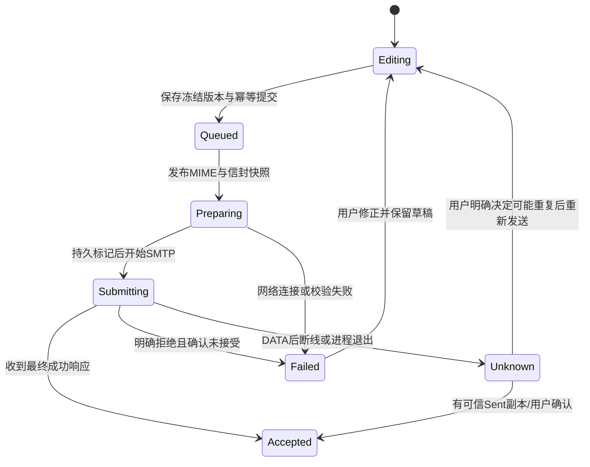

# 邮箱接入与邮件业务设计

## 统一接入边界

```text
ProviderProfile {
 key, imapDefaults, smtpDefaults, supportedAuthModes,
 guideStepsZh[3], identifyPolicy, specialFolderHints, timeoutPolicy
}
IMailSessionFactory.OpenImap(context, accountId, purpose, ct) -> IImapSessionLease
ISmtpSessionFactory.Open(context, accountId, ct) -> ISmtpSessionLease
IImapSession: DiscoverFolders / Snapshot / FetchHeaders / PeekBody / FetchFlags / MoveToTrash
ISmtpSession: Submit(FrozenEnvelope, FrozenMime, requireAllRecipients, ct)
```

Account保存已验证的服务端配置，业务层只使用能力接口。ProviderRegistry集中模板/兼容规则，不能在Compose/Search/Controller里写`if address.endsWith('163.com')`。同类通用配置仍可覆盖模板参数，必须严格TLS与端口校验，不将所有服务商当Gmail。

| 配置 | QQ | 163 | Gmail | generic |
|---|---|---|---|---|
| IMAP模板 | imap.qq.com:993 TLS | imap.163.com:993 TLS | imap.gmail.com:993 TLS | 用户填host/port与TLS/STARTTLS |
| SMTP模板 | smtp.qq.com:465 TLS | smtp.163.com:465 TLS | smtp.gmail.com:587 STARTTLS（465 TLS可选） | 用户填host/port与安全模式 |
| 默认认证 | 客户端授权码 | 客户端授权码 | OAuth2/XOAUTH2优先 | 明确选择服务端支持认证 |
| 兼容 | 能力协商 | 认证后、打开Folder前若ID能力存在发送固定应用名/版本/vendor | 应用专用密码兼容，须满足账号资格；不承诺普通Google密码 | 不猜测服务商，不盲发厂商命令 |

163的Identify是本应用声明，不伪装Outlook、不传设备唯一标识；MailKit提供该接口。[MailKit官方IdentifyAsync](https://mimekit.net/docs/html/M_MailKit_Net_Imap_ImapClient_IdentifyAsync.htm)

账号规范地址用于唯一预留：域名IDNA转ASCII并小写，本地部分NFC；QQ/163/Gmail按其常规大小写规则归一，generic不擅自合并区分大小写的本地部分；不将点号/加号别名强行视同一账号。catalog保存HMAC而非明文邮箱，但本用户MailAccount保存可显示地址。冲突一律“此邮箱已存在”，不泄露另一个用户身份。

## 连接、代理与超时

每Client串行使用；闲置连接60秒可回收，不为所有文件夹无限持有连接。账号认证/令牌刷新锁先于连接租约，不能持有数据库写事务等待网络。连接建议15秒、协议命令30秒；大正文/附件采用按进展续期的读取超时和显式取消，而不是无限总超时。测试数值不等于生产性能证明。

宿主ConnectionPolicy可解析当前Windows代理配置或受控本机显式HTTP/SOCKS代理，为MailKit及OAuth HttpClient统一注入；不假定系统浏览器走代理就代表IMAP也走。保留严格Google/邮箱端TLS校验，不关闭证书、不篡改用户代理/TUN。政策配置属宿主连接适配，不新增未要求的云端代理服务或代理管理产品。

服务端证书使用Windows信任链；学校邮箱私有CA应由用户在合法系统信任策略下部署，不提供accept-any-certificate开关。无法可靠区分认证失败/未启用IMAP时提示可能原因和可执行检查，不伪造确定性；能识别的厂商响应只映射固定错误码，日志不透传原文。

## Gmail OAuth

用户导入自己的Desktop客户端配置，后端验证固定Google auth/token端点，不接受JSON提供的任意请求地址。系统浏览器授权、PKCE S256、随机state、动态IPv4 loopback监听、离线授权取得Refresh Token；流程绑userId/accountId/unlockEpoch/截止时间。只处理一次回调，失败/用户切换立即作废。邮件scope为https://mail.google.com/，不能拿REST只读scope做IMAP认证。[Google桌面流程](https://developers.google.com/identity/protocols/oauth2/native-app)

Account内使用账号级single-flight刷新：expiresAt前60秒判过期，读取credential revision→网络刷新（无SQL写事务）→若响应无refreshToken保留旧值→新access/issuedAt/expiresAt及可能新refresh一同加密→短事务CAS revision且账号epoch仍匹配。移除/重授权已改变epoch时丢弃旧响应。invalid_grant只转auth-required；网络错按任务退避，不要求用户重复OAuth。时钟回拨时保守刷新，不把文件修改时间作为令牌年龄。

客户端配置及token只存用户密文，不回前端。Google External Testing有效期/测试用户/公开分发审核依服务商政策，阶段二小范围测试成功不代表产品已获得公开授权资格；实际分发前核验官方策略，不擅自改用Gmail REST或运营方代持授权项目。

## 阅读、已读与垃圾箱

列表先查本地，默认只聚合各账号inbox，排序INTERNALDATE；账号/文件夹视图是筛选，不是合并Conversation。详情提供头与附件元数据，正文独立GET命中缓存，否则幂等body-index/read任务BODY.PEEK获取。MimeKit解码UTF8、GB2312/GBK，错误charset按明确回退并提示降级；不因读正文改变Seen。

已读操作先保存MailMutation任务，后台在对应UIDVALIDITY下执行UID STORE +/-FLAGS (Seen)，再FETCH FLAGS确认后写本地；前端可以显示“待确认”，不能先把isRead当服务器事实。离线不报成功，取消/失败保留明确原因；多端随后变更以新的服务端值覆盖。

删除只移动到服务端垃圾箱：有MOVE则用UID MOVE；无MOVE但有UIDPLUS可COPY并获取COPYUID→标记特定UID Deleted→仅UID EXPUNGE该UID。禁止全Folder EXPUNGE，以免永久删除别人已标记邮件。能力不足或无可靠trash映射则返回TRASH_UNSUPPORTED，保留原信并提示用服务商客户端处理，不悄悄降级成永久删除。已在trash不能执行本产品“永久删除”。提交后刷新源/目标文件夹及未读数；移动改UID，不沿用源UID。

## 草稿与发送

Draft是独立聚合，无IMAP UID。新建选发件账号，字段验证收件人/主题换行注入；To/Cc/Bcc列表规范校验，正文UTF8。本地草稿Should功能可排后续迭代，但D04要求的失败保稿机制是Must基础，不能一起延期。保存使用If-Match，多个标签页不默默覆盖。

回复读取**真实收到的原邮件**Message-ID、In-Reply-To/References及Reply-To，生成`Re:`主题，In-Reply-To=原收到Message-ID，References继承原链并加入该ID；回复To优先Reply-To，否则From，排除自己重复地址。用户可编辑接收人。没有有效原ID时保留引用正文并明确线程信息不可用，不能凭主题伪造ID。

转发按负责人确认作为独立新邮件：`Fwd:`主题和引用正文，可带原发件/日期的可读引用；不设置暗示回复的In-Reply-To/References，不恢复会话合并功能。引用内容来自本机原邮件快照，源邮件后续删除不破坏已保存草稿。



```text
send(draftId, version, idempotencyKey):
  transaction: verify ownership/version; key+requestHash duplicate returns prior submission
               freeze draft version, attachment references; persist queued submission
  generate MIME with unique client Message-ID and Bcc-free visible headers
  publish private MIME file via staging/ready; envelope frozen in OutboxRecipient
  transaction: state=preparing; persist per-recipient envelope
  connect TLS/auth with short credential lease
  transaction: state=submitting (before non-idempotent SMTP transmission)
  submit using RequireAllRecipients policy; if any RCPT rejected, abort before DATA
  on final success: transaction submission=accepted, draft=sent; retain audit metadata
  on definitive pre-accept rejection: failed + stable error; keep draft and attachment files
  on DATA/response uncertainty or startup finding submitting: unknown; never auto-send again
```

SMTP接受不等于实际收到；UI“已提交邮件服务器”，不声称收件确认。IDEMPOTENCY只避免重复HTTP请求，不解决SMTP exactly-once。提交Message-ID和对端观察ID分别保存，不用二者相等作成功条件；Sent对账可组合时间窗口、收件集合、正文/附件摘要与References作为候选，歧义保留unknown，不能自动认定副本或补发。发送完成后服务商可能自动存Sent；不要无条件IMAP APPEND再制造重复Sent。

人工处置unknown使用resolveSubmission：确认已接受则记录resolution并置accepted；决定可能重复后再发则保存resolution=allow-new-submission及resolved_at，原提交state仍unknown以保留事实，草稿变editing并version++，释放活跃提交占用。下一次必须显式新Idempotency-Key发送，不因resolve接口本身就发信。未确认重复风险则拒绝，不提供无法到达的“UI手动重试”假流程。

## 附件和限制

BODYSTRUCTURE先取元数据，按part按需流式下载，25,000,000字节单项/200,000,000字节批次实际硬限，声明大小仅预检。写生成tmp、累计计数、SHA256、flush并同卷rename，之后DB标ready；中断文件不作为完整文件对外下载，默认重新拉该part，不伪造IMAP服务器支持字节Range断点。

出站附件每项和整封解码附件总量<=25MB，另按SMTP SIZE广告检查实际MIME大小（Base64膨胀可能更早触达服务商上限），提示服务商限制而不是改写本地25MB约束。批量浏览器下载逐个Blob释放，不一次把200MB全载入内存；文件名只用于Content-Disposition，不作为内部路径，禁止在线预览。
