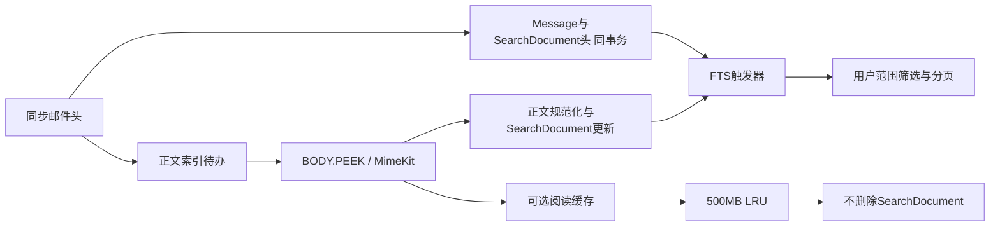

# 全文搜索与本地存储

FR-E01是Must，E02是Should；正文索引覆盖未读及阅读缓存淘汰邮件（D3）。已同步头部立即可查主题/发件人，正文建索引通过BODY.PEEK渐进完成；响应显式coverage.totalMessages/bodyIndexed/bodyPending/bodyUnavailable，complete=false时UI提示“正文索引进行中”，不能把未覆盖解释为没有匹配。

## 索引结构与更新

Message是归属/Folder/UID事实源；SearchDocument保存规范主题、发件人、完整提取正文。MessageSearch是external-content FTS5 trigram，rowid对应SearchDocument.message_row_id；触发器处理新增/更新/删除的旧token撤销。每次头批次及正文索引提交均和Message/覆盖标记同事务；不能由另一“索引服务”最终一致而不显示状态。

阅读缓存MessageBody与SearchDocument独立。淘汰正文仍能搜索正文；命中后正文已无缓存则在线PEEK重取，离线显示头和“正文未缓存”，不清除该结果。FTS/源正文属于敏感衍生数据，账号删除、F03及用户删除必须一同清理。索引不计500MB阅读配额，因此设置页分别显示缓存/索引/附件/总盘占用。



## 查询语义

首版输入为字面关键词，不开放原始FTS运算表达式；trim后NFC+应用层casefold，最大256字符。三个搜索域统一NFC/casefold的索引文本，原始显示文本不改。至少3个Unicode码点使用安全引用的FTS phrase（把双引号按FTS规则转义），1～2码点用参数化LIKE对SearchDocument三个规范列OR。LIKE里的`%`、`_`和转义符必须按字面转义；绝不字符串拼接SQL。SQLite默认LIKE不提供全面Unicode大小写折叠，所以在写入和查询两端统一规范，不把LIKE NOCASE当中文/Unicode语义。

```sql
-- 长词：服务端构造已转义phrase后作为$q绑定，不能把原输入直接拼MATCH语法
SELECT m.message_id,m.account_id,m.subject,m.internal_date_ms
FROM MessageSearch
JOIN Message m ON m.message_row_id=MessageSearch.rowid
WHERE MessageSearch MATCH $q AND m.server_state='present'
ORDER BY m.internal_date_ms DESC,m.message_row_id DESC LIMIT $limit;
-- 短词：绑定$like='%'+escapedLiteral+'%'；账号/日期等过滤同样参数化
SELECT m.message_id,m.subject,m.internal_date_ms
FROM SearchDocument d JOIN Message m USING(message_row_id)
WHERE (d.subject LIKE $like ESCAPE '\' OR d.sender LIKE $like ESCAPE '\'
       OR d.body LIKE $like ESCAPE '\') AND m.server_state='present'
ORDER BY m.internal_date_ms DESC,m.message_row_id DESC LIMIT $limit;
```

`trigram MATCH`短于3字符无法命中；LIKE带ESCAPE不能依赖trigram优化，短词大库可能扫描。这是已知成本，不能据1000封原型几毫秒推断任意大库达标。[SQLite FTS5官方说明](https://www.sqlite.org/fts5.html#the_trigram_tokenizer)

查询只打开当前用户库，账号/时间/附件/已读过滤必须同一WHERE取交集；默认所有本用户账号（可含停用账号已有邮件），不是所有本机用户。统一收件箱默认inbox与搜索默认全部已同步Folder不同，UI明确当前范围。cursor绑定会话、query/过滤摘要和最后收信时间/rowid；索引重建或条件变更需新首屏。新入库导致列表变化允许刷新，不声称分页是长期快照。

空串422；非法UTF/过长词422。长时间查询可取消/设置SQLite progress handler时间预算；达到预算返回QUERY_TOO_EXPENSIVE及建议缩小账号/日期，不返回伪“0条”。1秒目标按原1000封条件在集成测量；超大单正文不得静默截断，若资源不足则body_index_state=unavailable并coverage反映，后续可重试。

## 重建与一致性

FTS损坏而SearchDocument可用时锁写队列、进入search rebuilding状态，用FTS rebuild维护；失败旧状态不标complete。正文源丢失可重新排索引PEEK。重建期间查询返回SEARCH_REBUILDING或已有可靠快照，不能部分结果假称完整。索引删除由FK和触发器在同事务执行，孤儿检查对照Message↔SearchDocument↔FTS。

## 缓存与文件

正文缓存算法、账本CHECK与预淘汰事务见DATABASE_DESIGN；没有运行中长期pin而无法满足配额的问题：读取复制受控正文缓冲并结束读事务，再异步渲染。超过本用户配额的单正文可索引后不落阅读缓存，不能因为无法缓存而删除邮件头。附件缓存无未经需求批准的固定总配额，设置页显示盘占用；磁盘不足暂停下载、清临时数据并提示，不自动删除草稿附件。

FileObject状态为staging→ready→pending-delete。临时文件不在Web静态根，API根据归属及ready状态读取，拒绝任意路径。失效/无引用对象由CleanupOperation收敛；rename失败不标ready，DB失败留下orphan可核对恢复。清理正文不会清FTS，清全部本地邮件则两者清并暂停自动补拉；草稿和账号配置保留。

SQL逻辑载荷、实际DB字节、WAL字节、文件字节分别统计；checkpoint/VACUUM仅空闲维护，不能UI每次搜索做VACUUM。备份不走云端，不引入CR-07取消配置迁移功能。
