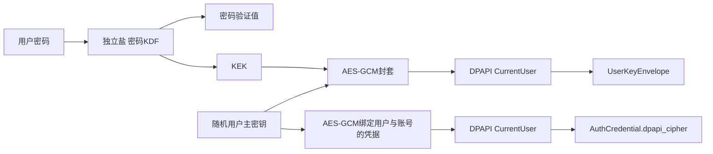

# 安全与隐私详细设计

安全目标是同一Windows账户内MailHub用户经UI/API的数据和凭据隔离、恶意网页隔离、可信邮箱TLS连接；不承诺抵御该Windows身份下任意恶意进程、管理员或内存取证。邮件库和FTS未做整库静态加密，不能把密码登录宣传为所有文件加密。M3证明的是隔离原型，正式流程如下。

## 候选比较与选择

| 方案 | 优点 | 代价与判断 |
|---|---|---|
| 共享库所有表owner_id | 少库、统计简单 | 每条查询/FTS/文件读取都可能漏过滤；首次团队协作风险大 |
| 每用户独立库+服务端会话 | 明确连接边界、误查询不会跨库 | 目录库需补偿与唯一预留；采用 |
| 仅DPAPI CurrentUser | Windows原生、已验证 | 同一Windows内B也能调用Unprotect，不能隔离A凭据；不能单独采用 |
| 密码直接加密每个凭据 | 密码层隔离 | 修改密码要重加密全部记录且难原子协调 |
| 随机用户主密钥+密码KEK封套+DPAPI | 密码改变只换主密钥封套，凭据按用户封装 | 密码遗失不可恢复；采用，算法使用.NET标准实现 |

## 密钥与密码完整流程

1. 注册先事务预留四槽之一。密码UTF8原样处理，不默默trim/归一化；10～128字符，拒绝超长以限制KDF资源。displayName用NFC及规范登录名唯一校验。没有云账号/找回邮箱。
2. 验证值`V=PBKDF2-HMAC-SHA256(password, passwordSalt, iterations, 32)`；passwordSalt随机32字节。固定时间比较。生产下限600000轮，阶段四在目标机校准并记录参数，不低于安全下限。每次验证使用存储版本参数，登录成功可升级。该参数是设计，不把原型SHA512/210000轮当产品标准。[OWASP密码存储指南](https://cheatsheetseries.owasp.org/cheatsheets/Password_Storage_Cheat_Sheet.html)
3. 每用户生成32字节随机`UMK`，另生成独立32字节kekSalt，派生`KEK=PBKDF2-HMAC-SHA256(password,kekSalt,iterations,32)`。不可复用验证值V为加密密钥。AES-256-GCM以12字节随机nonce、16字节tag封装UMK；AAD为有版本的规范UTF8 userId/keyId/用途/算法参数。
4. 把内层封套整体以`ProtectedData.Protect(...,CurrentUser)`保护后存catalog.UserKeyEnvelope；解封时DPAPI→KEK/AAD→UMK。登录只持有UMK租约，不解密各账号凭据。盐、KDF参数、版本不是秘密，但必须进入认证上下文防替换。[Microsoft DPAPI文档](https://learn.microsoft.com/en-us/dotnet/api/system.security.cryptography.protecteddata?view=windowsdesktop-10.0)
5. 凭据JSON（授权码或OAuth access/refresh及issued/expires元数据）以UMK用独立nonce AES-GCM保护，AAD绑定userId/accountId/credentialId/keyId/formatVersion；再DPAPI CurrentUser保护为AuthCredential.dpapi_cipher。数据库接口从不返回该Blob或任意解密入口。
6. 只有协议连接/必要OAuth认证请求申请CredentialLease，逐层解密，建立SASL/授权请求后立即释放及尽可能清零可控buffer。连接池仅保存已认证连接，不保存明文密码字段；续租也受当前解锁epoch及账号workEpoch约束。.NET字符串/第三方库可能有短时拷贝，禁止宣称绝对无内存残留，禁止自己的完整内存转储与授权请求日志。
7. 密码变更：先验证当前密码并暂停该用户工作，生成新验证盐/KEK盐；原UMK不变，创建新封套；同catalog事务CAS更新V、参数、封套、revision和auth_version；成功后撤销全部会话、清UMK，再登录。崩溃发生在提交前保持旧密码，提交后新密码有效；绝不先改验证值再单独写封套。用户库凭据不用批量重加密。

UMK暂留仅在已登录且未锁定期间；锁定/登出/切换/Windows会话锁定时撤销keyLease，取消账号工作并清密钥。不能为锁定用户后台自动同步而持久保存无密码可解UMK。这一行为必须在UI提示“锁定后暂停同步”，浏览器标签关闭本身不锁定，宿主仍可在有效会话期间工作。

## 会话和四用户

宿主一个活跃应用身份，最多四个持久用户。密码验证后签发随机256位不透明sessionToken，仅服务端存其摘要、userId、auth_version、unlockEpoch与绝对8小时期限；不放Cookie/localStorage/URL。宿主重启全失效。会话过期或显式锁定，任务暂停、事件流关闭、前端状态/正文/附件Blob清空。应用登录错5次冷却1分钟，连续后续窗口上限10分钟，独立于BR-02“邮箱认证错3次冷却10分钟”；所有冷却持久化，不能重启绕过。

切换先撤销旧身份，取消和等待旧用户任务安全边界，再认证新身份；失败保持锁定。仓储选择只来自SessionContext，不来自body.ownerId、URL路径或“当前界面用户”静态变量。任何ID越权统一404；搜索、缓存、下载、草稿、任务/事件流均适用，不仅检查账号列表。

## 桥接令牌、CORS及CSRF

- Kestrel只绑定127.0.0.1动态端口，拒绝IPv6/0.0.0.0监听。启动生成256位BridgeToken（宿主退出即失效，最长24小时后重新引导）和独立一次性bootstrap code（3分钟TTL、用后即废）；启动链接只在URL fragment，消费后history.replaceState清除。
- 同源POST bootstrap请求以JSON换BridgeToken；第二标签页需从托盘“打开工作台”取得新code，不把长期token放链接。BridgeToken证明访问桥接资格，X-MailHub-Session另证明用户身份，两者不可混用。
- 所有请求精确校验Host=`127.0.0.1:<实际端口>`，有Origin则须完全等于本地origin；拒绝`null`、跨源预检、跨站Fetch Metadata。API写请求必须有正确Origin及约定JSON/授权multipart类型；同源GET可没有Origin但仍验证两个token。不启用通配CORS，不反射Origin；拒绝localhost/外部域名Host防DNS rebinding。
- API不依赖Cookie，跨源表单/no-cors拿不到并不能设置完整授权头；返回CSP、X-Content-Type-Options:nosniff、Cache-Control:no-store、Referrer-Policy:no-referrer。静态资源无敏感数据，API/JSON不交ServiceWorker离线缓存。
- OAuth回环导航是独立监听器例外：state+PKCE+精确path/TTL，不能要求Google导航携带BridgeToken，也不能因此开放普通API。授权码和callback query不写访问日志。

## HTML邮件

原始MIME由MimeKit解码，正文视为不可信。使用已验证的严格DOMPurify白名单（基本段落、强调、列表、表格；无属性），移除script/iframe/object/embed/form/svg/math/base/meta、所有事件属性、src/srcset、远端URL/CSS/字体。清洗后仅置入独立`sandbox=""`的srcdoc框；外层框是应用隔离容器，**邮件内iframe一律移除**。

邮件文档CSP：`default-src 'none'; script-src 'none'; connect-src 'none'; img-src 'none'; style-src 'none'; frame-src 'none'; base-uri 'none'; form-action 'none'`。父页面script-src self，不允许unsafe-eval（Vue编译产物）；根页面的样式策略与邮件无关。不给阅读框allow-scripts或allow-same-origin，不传入BridgeToken/Session，不接受邮件的postMessage驱动API。

默认拒绝所有外部图片，不提供后端任意URL图片代理。首版保守保留文字格式，CID等丰富展示只有单独设计/验证后再启，不因“支持HTML”默认保留主动资源。下载附件固定attachment、不内联执行；不做CR-04已取消在线预览。

## 文件、日志、清理与恢复

根目录继承仅当前Windows身份、SYSTEM和管理员所需ACL，不授Everyone；缓存文件生成随机名，最终导出名去控制字符/路径段并安全编码。禁止相对路径逃逸和重解析点越界。对同Windows恶意进程的静态邮件文件保密不作承诺，备份同样敏感。

日志白名单：UTC、级别、requestId、模块、稳定错误码、随机资源ID、时延/计数。禁止邮箱完整地址、正文、附件名、Subject、密码、令牌、SMTP响应全文、MIME原文及用户请求体。HTTP访问日志禁敏感query，OAuth代码用内存state映射；自建崩溃报告只写异常类型和稳定阶段，不收完整dump。

密码遗失没有可逆找回或绕过认证重设接口；既有凭据不能解封。优先一致备份加原Windows身份及原密码恢复；没有备份时只能明确接受丢失后离线维护清除该用户并重建，邮件可再授权拉取，本地草稿不可保证恢复。DPAPI身份/系统密钥丢失同理，不伪报可跨机器恢复。坏库不静默覆盖为空库。

退出用户/移除账号按DATABASE_DESIGN的持久清理操作推进；SQLite secure_delete、FTS清除、WAL checkpoint及空闲VACUUM降低残留，但SSD/文件备份上不能保证法证安全擦除。用户主动导出的附件由用户管理，应用移除账号不擅自删除其Downloads文件。

## 安全验收

后续产品测试逐项覆盖：同进程用户切换时跨ID/搜索/正文/下载/事件流与旧会话拒绝，错误密码和改密崩溃边界，账号凭据交换AAD拒绝，刷新与移除并发，实际Host/Origin/无token，HTML恶意脚本/iframe/图片无请求（含观察器正对照），日志/备份抽样。阶段二原型PASS保留，不把这些产品用例标PASS。
