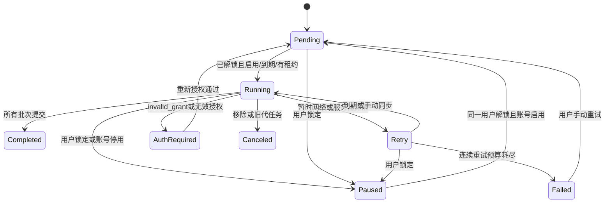
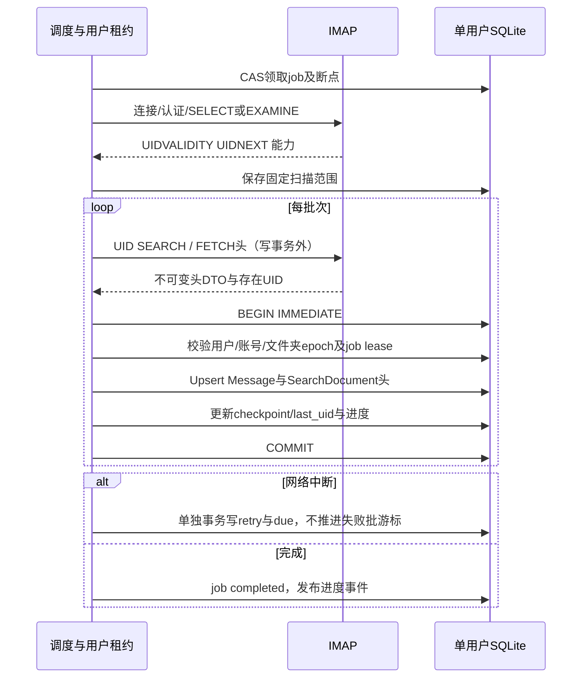

# 邮件同步引擎详细设计

目标是FR-B01～B08、NFR-05/11及BR-03/05/06。阶段二真实证据只有20个UID和主题FTS的断网/独立进程恢复；下面是完整产品设计，不称已验证完成。

## 状态与调度

账号状态遵循原八状态：未接入/配置中/授权中在向导与短期验证流程；持久账号有authorized/syncing/retry/auth-required/disabled，移除是维护子状态。多个worker存在时状态由协调器归并，不由单worker随意设idle；授权中禁止同步。



默认自动10分钟，用户可配5～60（FR-B04 Should实现时启用）；手动单账号/全部立即持久入队，5秒内返回jobId。单账号并发<=3、全局<=5硬限，先账号信号量后全局，不持一个资源等待其他业务锁；调度公平轮转防正文索引饿死交互任务。每文件夹仅一header/reconcile写协调器，IMAP每连接串行命令。

失败attempt从0开始：第一次失败next=now+1min，后续2/4/8min；四次自动重试后仍失败则failed待手动/下个已配置周期显式新轮次，不以8分钟无穷刷服务商。网络恢复事件唤醒调度检查，不自动绕过nextRunAt；用户手动重试按基线重置网络退避，但不得绕过认证冷却。认证连续三次失败冷却10分钟，过期OAuth先刷新一次再判认证失败，网络错不计认证失败。

SyncJob持久化state/attempt/next_run_at_ms/lease_owner/lease_expires/expected_account_epoch。进程重启先锁定，登录后把租约过期的running转pending/retry，保留已提交checkpoint；提交需CAS验证租约及版本。取消原因（锁定/停用/清理）不是网络失败，不累计退避。

## UID模型与首次90天

RemoteMessageKey由账号、Folder、UIDVALIDITY、UID组成；UID稀疏，不是行号。Message-ID仅邮件业务引用。所有序号是UID，不使用消息sequence number做永久身份。[IMAP标准](https://www.rfc-editor.org/rfc/rfc9051.html)

每轮打开文件夹先获取UIDVALIDITY、UIDNEXT及能力；捕获`upper=UIDNEXT-1`（无可用UIDNEXT时SEARCH UID得到最大值，空箱upper=0）。本轮只处理固定范围，之后新来的留下一轮，不能把连接结束时最新UIDNEXT直接当已同步游标。

首次cutoff=任务创建UTC-90天；IMAP SINCE仅按日期，应放宽到前一天并在FETCH后的INTERNALDATE按精确UTC过滤，避免时区遗漏。保存固定cutoff及upper，不在重试时滑动90天窗口。以小UID区间SEARCH+分页FETCH最多200头（默认100）获取存在的UID；确认不存在/时间窗外的UID也算已覆盖区间，只有区间成功事务后才推进next_uid；首次完成后Folder.last_uid可到本轮upper，即使最近90天集合为空。

增量范围为`(last_uid,upper]`，不再用收信日期过滤新UID，避免漏掉新APPEND的旧日期邮件。UID范围SEARCH结果不完整、服务器FETCH漏项必须重查确认expunge，不能仅“取返回最大UID”跳过未处理项。轮次中断复用SyncCheckpoint范围/next_uid；幂等唯一键使重复批次不重复。

## 核心流程与事务



```text
run(job, immutableUserContext):
  lease = claimByCAS(job, utcNow); acquire account<=3 then global<=5
  guard unlockedUser && account.enabled && expectedAccountEpoch
  connectWithCredentialLease(); open folder; read actualUidValidity
  if validity changed: rebuildGeneration(); return
  checkpoint = loadOrCreateFixedRange(job)
  while checkpoint.nextUid <= checkpoint.upper:
    batch = networkSearchAndFetchCoverage(checkpoint) // 不持SQLite写事务
    on incomplete response: re-search missing UIDs; retry unless confirmed absent
    begin writer transaction
      verify epochs and lease still match
      upsert Message keyed by folder/validity/uid
      upsert SearchDocument subject/sender without overwriting prior indexed body
      insert body-index work only if not already indexed/current
      advance checkpoint to coveredRangeEnd+1; advance folder.lastUid to coveredRangeEnd
      update job.progress and renew lease
    commit
  enqueue reconciliation; mark job completed; release leases
catch transient:
  rollback current DB transaction if any
  persist job.retry + exact backoff due; retain last committed checkpoint
catch authInvalid:
  persist auth-required/cooldown; never hot-loop refresh
finally close connection; clear credential lease; release semaphores
```

fullSearchDocument.body只能由成功body-index任务更新；头部重拉不能把正文变回空串。每个Message至少有SearchDocument头行；新增头和索引行同事务，正文覆盖标pending直到解析/索引提交。网络读取结束后发生锁定/删除，epoch不匹配必须丢弃DTO而非提交到新用户库。

## UIDVALIDITY变化

立即使Folder.epoch++并标rebuilding，取消旧代任务/操作，事务清理旧代头/FTS/正文/附件引用，设置新uid_validity、last_uid=0及新的重建checkpoint；账号其他Folder不受影响。按照FR-B06/BR-05重新拉取该文件夹全部服务器邮件，不把首次90天过滤应用到此全量重建。旧代正文请求返回STALE_GENERATION；不按相同UID复用旧内容。异步文件清理有CleanupOperation，物理删除不混在长SQL事务里。游标与新任务创建同提交，崩溃不能留下“新代已完成”的假状态。

## FLAGS、删除与文件夹对账

有CONDSTORE/QRESYNC则使用服务器支持的MODSEQ/vanished优化，前提为同代；无能力时周期批量FETCH FLAGS及UID集合，不只拉新UID。已读值以服务端确认事实写回，另一个客户端更改能覆盖旧本地值。

UID集合对账使用FolderScan/ScanUid保存完整扫描及固定upper，completed之前不得判定任何邮件消失。扫描完整且epoch一致后，只处理范围内确定缺失的旧UID，事务删除其Message/索引/缓存，安排无引用文件清理；这表示服务器既有删除的本地镜像，不是FR-C06用户永久删信。扫描出错保留原数据，重启废弃未完成扫描重来。

每轮LIST对账文件夹；INBOX按协议语义处理大小写，其他文件夹名按服务器原值。无可靠MAILBOXID时改名不能靠显示名猜同一文件夹；标旧映射missing，重新发现并同步，避免错误游标迁移。垃圾箱/Sent按SPECIAL-USE优先、模板建议其次、无法判定时不随意移动。

## 离线与状态

网络失败不清空UI缓存；列表和已有正文照读，未缓存正文返回offline-unavailable及中文说明，不伪装空正文。网络恢复按调度继续待办；停用、锁定、F03暂停不会自动补拉。正文索引后台逐步覆盖全部已同步消息；头同步完成与全文建索引完成是两个进度，不把pending搜索结果当“没有邮件”。

## 关键异常

| 触发 | 保证与行为 |
|---|---|
| FETCH中断/超时 | 本批不推进，已提交保留；准确持久退避 |
| 事务失败/磁盘满 | 整批回滚，不能先发完成事件；存储错误暂停写入，避免网络无限重拉 |
| 任务进程退出 | 过期租约重新领取；header/FTS/checkpoint重放幂等 |
| UI切换/账号移除 | 捕获context失效，取消连接，旧worker提交被epoch guard拒绝 |
| 令牌过期 | 账号级single-flight刷新及CAS；invalid_grant要求重授权 |
| 缺UID/EXPUNGE | 重查服务端确认后才视不存在；不以数量差猜游标 |
| 服务器限流 | 记录脱敏代码与建议时间；到期取max(标准退避,服务器明确retry-after) |

实现验收见TEST_PLAN的T-FR-Bxx/NFR-11；阶段三仅验证设计SQL/合同一致性，不重复阶段二真实登录。
