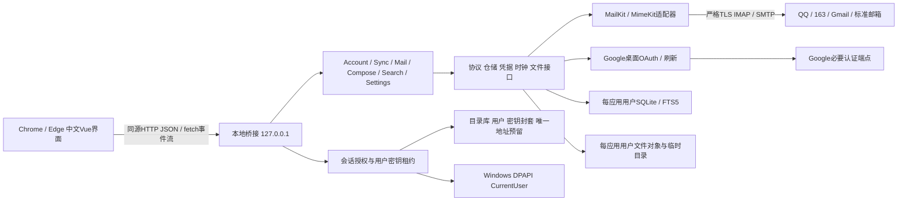
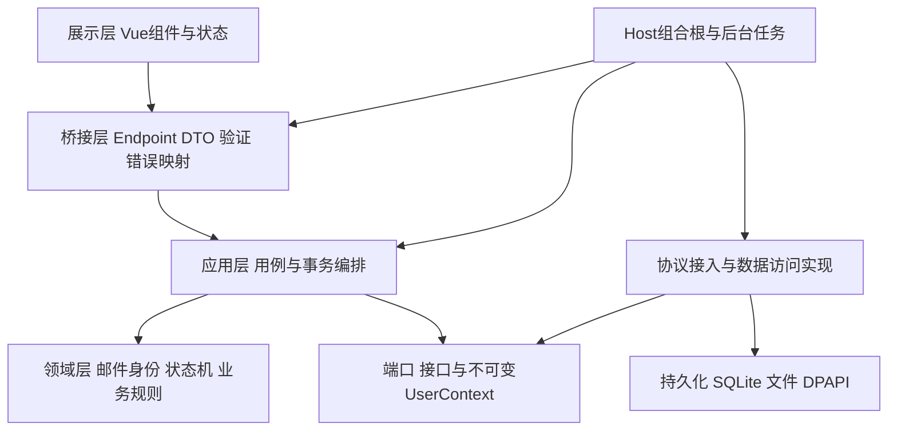
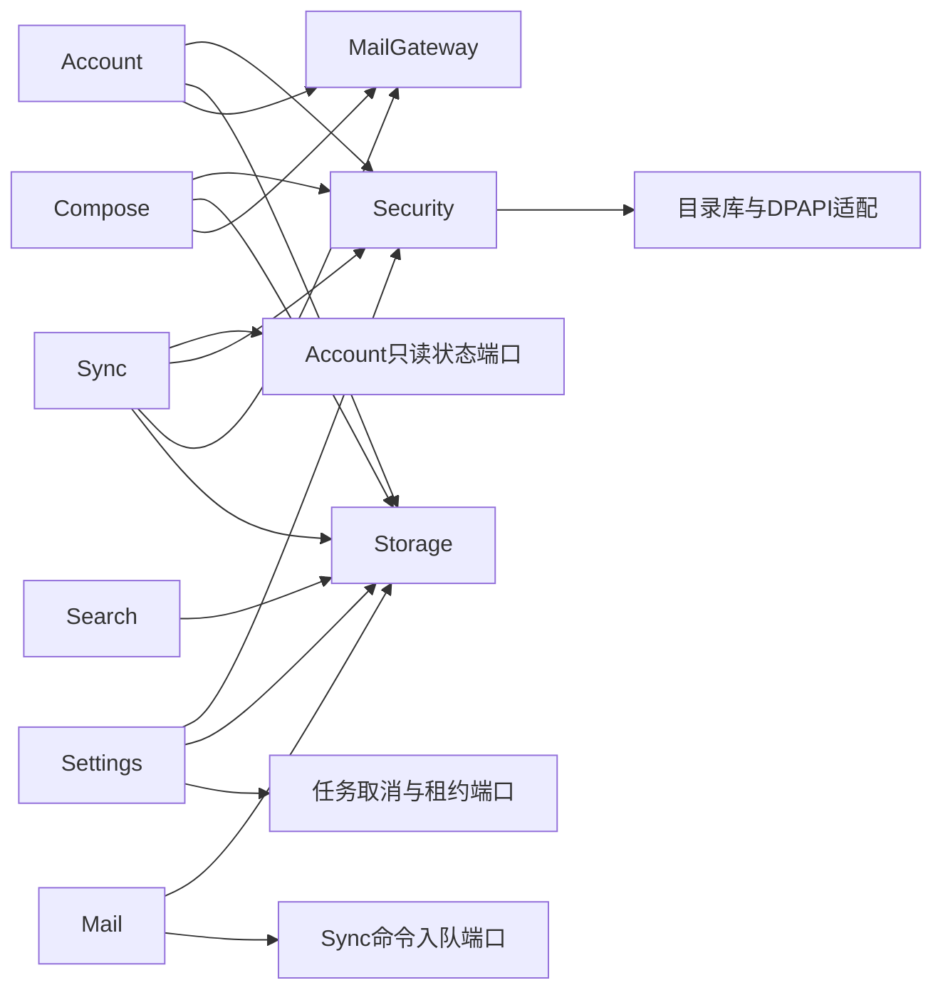
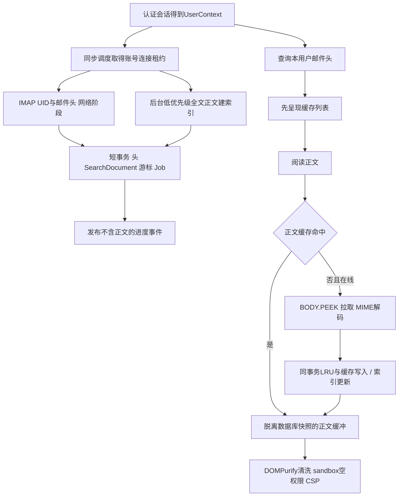
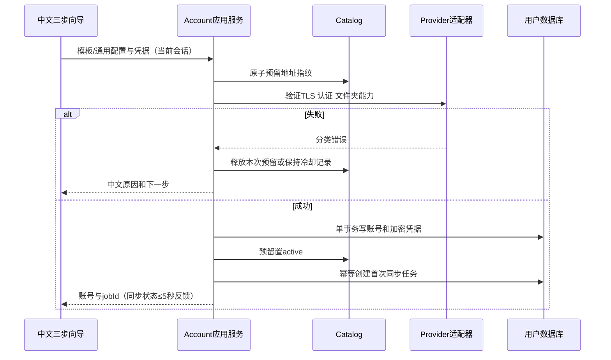

# 系统总体架构

MailHub是Windows11用户级单宿主的模块化本地应用。Chrome/Edge访问宿主同时提供的静态Vue资源和API；浏览器无IMAP/SMTP或DPAPI能力，也不持有邮箱凭据。启动路径为快捷方式→宿主单实例检查→绑定127.0.0.1动态端口→生成一次性引导链接→系统浏览器→应用用户密码登录。

## 总体边界

邮件协议及必要Google认证是用户授权后的出网例外；不向运营方上传数据，不使用CDN/云AI/遥测。账号凭据解密只在建立协议连接或OAuth认证请求的短生命周期中发生；用户登录只解封主密钥，不解密所有凭据。

## 分层与模块依赖

业务模块不直接引用其他模块的私有仓储，不互相调用Controller。事务协调通过Application的UnitOfWork把头/索引/游标一次提交；Search既不调用邮件服务器也不以搜索请求偷偷拉正文。Host是唯一DI组合根，Domain不依赖MailKit、HTTP、SQLite或Vue。

## 核心数据流

## 生命周期和失效边界

- 按Windows SID命名的互斥量维持单宿主，锁文件不含长期令牌。第二次启动通过仅当前SID可访问的命名管道请求已有宿主生成新引导码，不再开第二写宿主。命名管道消息仅OpenWorkspace/Shutdown，不传邮件。
- 不是Windows Service，无管理员安装前提，无开机自启。浏览器关闭不终止宿主；托盘“退出/锁定”取消任务、撤销会话、清密钥。一次活跃应用用户的约束适用于所有标签页，切换使旧会话全失效。
- 正常退出：停止接单→取消可取消网络I/O→等待短DB提交→释放租约→将未完成任务持久化→清密钥→停止Kestrel。SMTP submitting无法安全判定时持久化unknown，不因退出自动重发。
- 异常退出：重启先锁定；用户登录后回收过期任务租约、核对清理日志、恢复retry。锁定用户不解密凭据、不后台同步；只作不需用户密钥的目录级恢复。
- 事件流只是进度提示，断连不丢任务；客户端重新GET状态。服务端提交后才发事件，事件不含地址、正文或令牌。可退化成2秒状态轮询，避免把UI通信变成核心任务依赖。

## 添加账号流程

目录库与用户库不采用跨库“全局事务”。每步有CatalogOperation持久状态，按账号UUID幂等补偿；reserved地址不能被另一个用户抢用，过期清理必须先确认用户库无对应账号。完整SQL及恢复策略见DATABASE_DESIGN。
