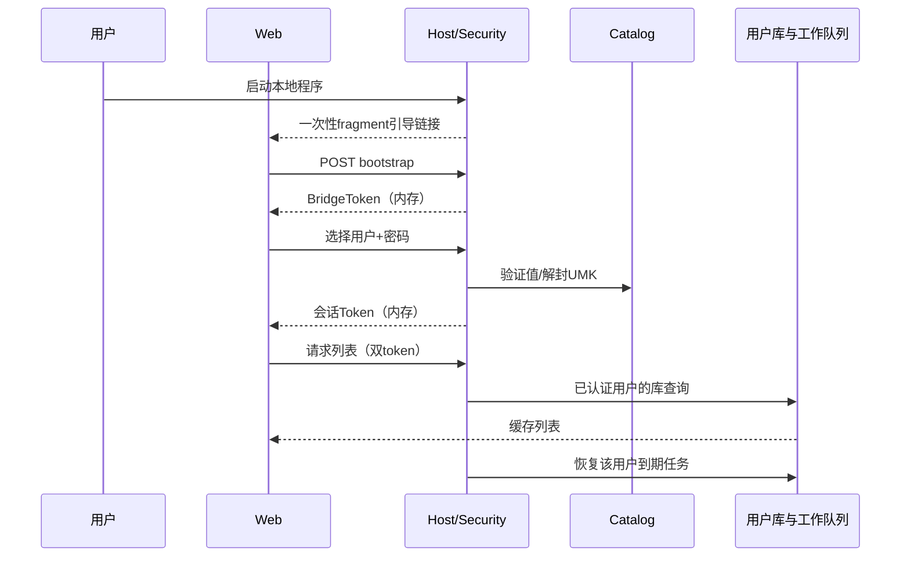

# MailHub 系统详细技术设计

版本：1.0设计稿；2026-11-15；待技术负责人审核。首版仅Windows11、Chrome/Edge最新版。沿用已确认Vue3.5/TypeScript/Element Plus/Vite、.NET10、MailKit/MimeKit、SQLite/FTS5、DPAPI。此目录将需求和阶段二证据转为产品实施合同，不是产品已开发或全功能验收通过的声明。

## 阅读入口与权威关系

| 文件 | 用途 |
|---|---|
| [DESIGN_INPUTS](DESIGN_INPUTS.md) | 已确认约束、实际能力/原型边界、差异及合理默认 |
| [SYSTEM_ARCHITECTURE](SYSTEM_ARCHITECTURE.md) | 部署、层次、依赖、数据流和启动/退出 |
| [MODULE_DESIGN](MODULE_DESIGN.md) | 八模块职责、内部端口和团队协作边界 |
| [DATABASE_DESIGN](DATABASE_DESIGN.md) / [DATA_DICTIONARY](DATA_DICTIONARY.md) | ER、逐字段/索引/生命周期、事务、迁移和清理 |
| [API_DESIGN](API_DESIGN.md) / [openapi.yaml](openapi.yaml) | 51个operation、参数/DTO/安全/分页/错误 |
| [SYNC_ENGINE_DESIGN](SYNC_ENGINE_DESIGN.md) | 全量/增量、checkpoint、FLAGS/删除、持久调度 |
| [EMAIL_INTEGRATION_DESIGN](EMAIL_INTEGRATION_DESIGN.md) | 厂商、OAuth、阅读、整理、草稿及发送状态 |
| [SECURITY_DESIGN](SECURITY_DESIGN.md) | 会话、封套、改密、隔离、HTML、日志与恢复 |
| [SEARCH_STORAGE_DESIGN](SEARCH_STORAGE_DESIGN.md) | 中文长短词、覆盖状态、缓存/附件 |
| [ERROR_HANDLING_DESIGN](ERROR_HANDLING_DESIGN.md) | 每类异常的用户文案、重试及一致性 |
| [REQUIREMENT_TRACEABILITY](REQUIREMENT_TRACEABILITY.md) / [TEST_PLAN](TEST_PLAN.md) | 原35FR/14NFR/10BR/AC/CR及未来产品用例 |
| [ADR](ADR/) | 0004～0011八项设计决策，旧ADR保留 |
| [STAGE3_DESIGN_REVIEW](STAGE3_DESIGN_REVIEW.md) | 交叉检查实际结果、风险及审核门槛 |

SQL是字段/约束权威，OpenAPI是外部接口权威；SQL/API之间的驼峰映射见[DTO_FIELD_MAPPING](DTO_FIELD_MAPPING.md)。内部逻辑仍以对应模块设计为准。若出现冲突必须修正文档后再开发，不能选择对当前实现方便的一份。

## 系统怎样运行

1. 用户启动本机宿主，单实例托盘进程同源提供Vue静态资源/API，不依赖网络加载UI。一次性引导换进程令牌，再以应用用户密码登录。
2. 密码验证后解封该用户随机主密钥及服务端会话，连接只选择该用户物理库。账号参数/凭据引用先校验再保存，163身份声明、Gmail认证及代理政策集中于协议适配器。
3. UI先显示本地统一inbox；Sync按持久任务拉头并同事务写邮件、SearchDocument和游标。全文正文索引独立低优先级PEEK，覆盖率显式呈现；阅读正文按需缓存。
4. 用户主动已读/移垃圾箱由服务器确认后更新本地事实。正文阅读本身不设Seen；缺安全MOVE降级能力时不删除。
5. Compose先保存草稿/冻结MIME和信封，再SMTP；明确失败保留草稿，提交中断unknown不自动重发。回复关联实际收到原邮件头，转发独立，不按主题合并会话。
6. 锁定/切换撤销旧会话、连接及密钥租约；重启重新登录，随后从持久checkpoint/队列恢复。状态数据不会依赖浏览器标签存活。

## 产品级不变量

- 四应用用户完全经服务端授权，不能只做前端切换；DPAPI不自动提供应用用户隔离。凭据没有可逆密码找回。
- 一个账号/Folder代次中UID唯一，游标只能在整个覆盖区间原子提交后推进。网络无DB写锁；旧epoch/租约不能提交。
- 邮件头、索引源、checkpoint同批原子；正文缓存与索引生命周期分开；任何已提交阅读缓存总量<=limit。
- 文件/跨库/网络不是SQLite联合事务，使用持久意图与补偿；接口不提前声称完成。
- SMTP接受不等于收到；unknown不可自动重发，幂等键只能防HTTP重复，不声称SMTP exactly-once。
- 原生邮件HTML、附件都不可信；主页面无原HTML，阅读sandbox无脚本/网络，原附件只下载。

## 性能预算与实现策略

以下是实现目标，不是本阶段实测结论。阶段二仅支持存储层1000封搜索等已注明范围。

| 原指标 | 策略/计量边界 | 未达标时处理 |
|---|---|---|
| 缓存可用首屏<=2秒 | 已登录且本地有头；同源静态资源、按需Element Plus、首50条索引查询，网络同步不阻塞列表；原NFR01五次中位数 | 分拆资源/虚拟表格/减少首屏状态请求；不移除密码或索引来刷指标 |
| 1000封列表交互<=100ms | 虚拟行、稳定cursor每页50、只展示头，滚动不触发逐封正文 | 记录主线程/渲染与SQL各段；禁止把后台查库时间冒充交互 |
| 单账号200头<=30秒/10Mbps | UID分批FETCH Envelope/Flags/InternalDate/Size/BodyStructure，默认100批，网络外解析/短事务提交，正文另任务 | 定位RTT/厂商限流/事务时延，不放宽TLS；保留实测失败与优化 |
| 1000封搜索<=1秒 | FTS长词+短词LIKE、合理过滤/取消、结果每页50；按原NFR04三次计量 | 超大库短词提示缩小范围，不伪装零命中；后续再评估索引优化 |
| 默认正文500MB | 单用户500000000字节逻辑正文硬CHECK；同事务预淘汰 | 超大正文不缓存，保持独立索引；真实总盘占用单列 |
| 附件25MB/批次200MB | 服务端预检+实际流累计，顺序下载/释放Blob，独立staging文件 | 超限明确拒绝，不发布半文件、不无限内存拼装 |

建议读取连接短租约、单库写队列有界（默认256命令，满则503并保留业务任务）；查询取消、网络限时、HTTP JSON默认32MiB部署上限及附件25MB流式限额分开。原需求未给定的大正文/数据库规模不擅自改业务上限，资源不足给明确可恢复错误，禁止静默截断正文索引。

## 设计交付到下一阶段

阶段四据本目录建立工程和OpenSpec：每模块Specs按FR/T编号拆，Proposal记录本次设计边界，Design引用ADR及SQL/OpenAPI版本，Tasks链接operationId/迁移/未来代码路径。此处不预写不存在的代码完成状态，不现在运行openspec init或创建Git分支。D1技术栈保持；SQLite含官方WAL修复版本的兼容锁定已获负责人允许，实际包版本和运行库核验在阶段四完成。

平台CR-08及FR-D02解释已确认。当前详细设计整体审核、AC13/14补充及ADR的设计参数待负责人审阅；合理默认在DESIGN_INPUTS明确，不因这些默认就跳过审核进入工程阶段。
